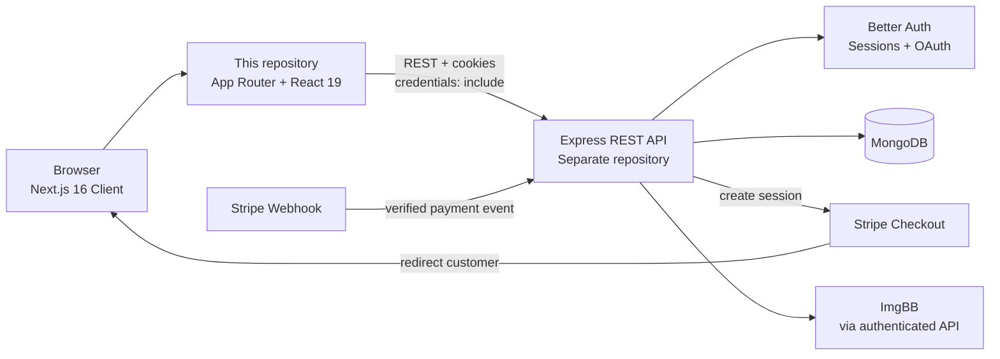

<div align="center">

# ✨ SalonBook — Client

**A polished, role-based salon booking interface built with Next.js 16.**

A production-style client application for discovering services, requesting
appointments, managing bookings, and administering a salon — connected to a
separate Express REST API.

[](https://nextjs.org/)
[](https://react.dev/)
[](https://www.typescriptlang.org/)
[](https://tailwindcss.com/)
[](https://zod.dev/)
[](https://www.better-auth.com/)
[](https://sonner.emilkowal.ski/)
[](https://vercel.com/)
[](https://www.mongodb.com/)
[](https://stripe.com/)
[](https://expressjs.com/)
[](https://github.com/Rakib304832/salon-client)

</div>

---

## 📑 Table of contents

- [Overview](#-overview)
- [Project links](#-project-links)
- [At a glance](#-at-a-glance)
- [Architecture](#-architecture)
- [Technology stack](#-technology-stack)
- [Features](#-features)
- [Screen map](#-screen-map)
- [Project structure](#-project-structure)
- [Quick start](#-quick-start)
- [Environment variables](#-environment-variables)
- [Available scripts](#-available-scripts)
- [API contract](#-api-contract)
- [Security model](#-security-model)
- [Deployment](#-deployment)
- [Verification](#-verification)
- [Troubleshooting](#-troubleshooting)
- [Final notes](#-final-notes)

---

## 🧭 Overview

SalonBook is a **two-part web system**:

1. **This repository — the client.** A Next.js App Router application that
   renders every screen a customer, guest, or salon admin sees.
2. **A separate Express REST API.** That service owns authentication, MongoDB,
   business rules, Stripe Checkout/webhooks, and ImgBB image uploads.

This separation is intentional. The browser never talks directly to MongoDB,
Stripe, or ImgBB. It only calls the Express API using cookies and
`credentials: "include"`. The client knows the API origin from
`NEXT_PUBLIC_API_URL`; it never embeds a secret.

> **Important:** UI guards in this repository improve user experience. The
> Express API must still enforce roles, blocked accounts, ownership, and payment
> state. A browser can skip UI checks; it cannot skip server checks.

---

## 🔗 Project links

| Resource | Link |
| --- | --- |
| Client repository | <https://github.com/Rakib304832/salon-client.git> |
| Server repository | <https://github.com/Rakib304832/Salon-server-site.git> |
| Live deployment | **Pending** — replace this after the final Vercel/production deployment |
| Manual test guide | [docs/VERIFICATION.md](docs/VERIFICATION.md) |

---

## ⚡ At a glance

| Area | What this client delivers |
| --- | --- |
| **Public** | Salon home page, six featured services, API-derived category tiles, searchable/filterable catalogue, and protected service details |
| **Customer** | Sign-up/sign-in, Google auth entry point, dashboard statistics, appointment history, profile editing, and payment return pages |
| **Admin** | Role-guarded dashboard, service CRUD, appointment workflow, user management, read-only transactions, and admin profile |
| **Payments** | Stripe-hosted Checkout redirect and verified success polling — the client never mutates payment status |
| **Design** | Salon-themed responsive layout, desktop tables, mobile cards, skeletons, empty/error states, toasts, and branded 404/error pages |
| **Accessibility** | Skip link, labelled controls, focus-visible rings, focus-trapping modal, Escape-to-close overlays, and keyboard-accessible profile menu |
| **Security** | No secrets in the browser, no local token storage, cookie-based sessions, and server-owned roles/blocked state |

---

## 🏗 Architecture



### Request flow

```text
User action
  → typed API module in src/lib/api
  → fetch with credentials: "include"
  → Express route validates session/role
  → MongoDB or Stripe/ImgBB integration
  → typed response
  → Sonner toast + UI update
```

The client uses a small typed API layer instead of calling `fetch()` from every
component. One `ApiError` type normalises transport errors, validation errors,
401s, and 403s so screens can respond consistently.

---

## 🧰 Technology stack

| Icon | Technology | Version | How it is used |
| --- | --- | --- | --- |
|  | **Next.js** | `16.4.6` | App Router, Server Components, routing, metadata, production builds |
|  | **React** | `19.3.0` | Component UI, hooks, forms, and client interactions |
|  | **TypeScript** | `^5` | Typed props, API responses, helpers, and compile-time checks |
|  | **Tailwind CSS** | `4.3.3` | Utility styling and CSS-first `@theme` design tokens |
| 🔐 | **Better Auth** | `^1.7.27` | Client auth calls to the Express server; Google sign-in entry point |
| 📝 | **React Hook Form** | `^7.92.0` | Performant form state and validation flow |
|  | **Zod** | `^4.6.7` | Shared schemas for sign-in, sign-up, booking, profile, and services |
| 🔔 | **Sonner** | `^2.0.8` | Consistent success/error toasts |
| ✨ | **Lucide React** | `^1.77.0` | Decorative and semantic interface icons |
| 🧩 | **clsx + tailwind-merge** | `^2.1.1` / `^3.7.1` | Safe conditional class names via `cn()` |
| ✅ | **ESLint** | `^9` | Code-quality checks |
|  | **Vercel** | — | Recommended hosting target for the Next.js client |
|  | **Express** | External | REST API host — not inside this repository |
|  | **MongoDB** | External | Database host — accessed only through the API |
|  | **Stripe** | External | Hosted Checkout and webhook-backed payment status |

---

## 🚀 Features

### Public experience

- Responsive salon landing page with hero, story, category tiles, and six active
  featured services.
- Service catalogue with debounced search, category filtering, price sorting,
  and URL-synced filters.
- Explicit loading skeletons, empty states, API error states, and retry actions.
- Service details with price, duration, category, description, image fallback,
  and an authentication-aware booking form.
- Guest visitors are redirected to `/sign-in` with a safe return URL; blocked
  accounts cannot open detail pages.
- Footer with email, telephone, address, opening hours, and social links. Values
  live in `src/lib/constants.ts` and are clearly marked as sample details until
  replaced with real salon information.

### Customer experience

- Better Auth sign-in/sign-up through the Express API, plus Google auth entry.
- Customer dashboard with server-calculated total, pending, confirmed,
  cancelled, and paid statistics.
- Appointment cards with service image, category, date, time, status, and payment
  state.
- Appointment history filters for status **and** payment state; filters combine
  and clear together.
- Details dialog, pending cancellation, and Stripe **Pay now** for confirmed,
  unpaid appointments.
- Profile editing for name, phone, and image. Email, role, and blocked state are
  deliberately read-only.
- Authenticated image upload through `/api/uploads`; the ImgBB key stays on the
  server.

### Admin experience

- Role-guarded admin dashboard with server statistics, revenue overview, popular
  services, total requests, and confirmed appointment counts.
- Service management with create/edit modal, upload-required images,
  Active/Inactive status control, activate/deactivate actions, and delete
  protection tied to live bookings.
- Appointment management with server-side filters, details dialog, and
  confirm/cancel actions that follow the server state machine.
- User management with search and filters. Only customer rows offer
  block/unblock; roles remain server-assigned.
- Read-only Stripe transaction history with explicit currency codes and correct
  cent-to-major-unit conversion.
- Admin profile editing reuses the shared profile form while keeping privileged
  fields server-owned.

### Shared quality layer

- Reusable `Button`, `Input`, `Select`, `Textarea`, `Badge`, `Modal`,
  `ConfirmDialog`, `Skeleton`, `Spinner`, `EmptyState`, and `ErrorState`.
- Central route map, status labels, category lists, and time slots.
- Shared appointment presentation helpers that safely handle populated or
  unpopulated `serviceId` values.
- Branded 404 page and root error boundary with retry and safe navigation.
- Keyboard support: skip link, focus return, focus trap, Escape handling, and
  an accessible profile dropdown.

---

## 🗺 Screen map

| Route | Access | Purpose |
| --- | --- | --- |
| `/` | Public | Home, categories, featured services |
| `/services` | Public | Searchable/filterable catalogue |
| `/services/[id]` | Signed-in | Protected service details and booking request |
| `/sign-in` | Guest/auth | Sign-in and Google auth entry |
| `/sign-up` | Guest/auth | New customer registration |
| `/dashboard/customer` | Customer | Overview and statistics |
| `/dashboard/customer/appointments` | Customer | Appointment history |
| `/dashboard/customer/profile` | Customer | Profile editing |
| `/dashboard/admin` | Admin | Salon overview and reporting |
| `/dashboard/admin/services` | Admin | Service CRUD |
| `/dashboard/admin/appointments` | Admin | Appointment workflow |
| `/dashboard/admin/users` | Admin | Customer search and block/unblock |
| `/dashboard/admin/transactions` | Admin | Read-only Stripe history |
| `/dashboard/admin/profile` | Admin | Admin profile editing |
| `/booking/success`, `/payment/success` | Public | Verified Stripe success page |
| `/booking/cancel`, `/payment/cancel` | Public | Safe checkout cancellation/retry |
| `/access-denied` | Public | Wrong-role destination |
| `/account-blocked` | Public | Blocked account explanation |

> The success aliases are `/booking/success` and `/payment/success`. Both read
> the same verified session endpoint.

---

## 📁 Project structure

```text
salon-client/
├── docs/
│   └── VERIFICATION.md          # Manual smoke-test checklist
├── public/                      # Static assets and favicon
├── src/
│   ├── app/
│   │   ├── (auth)/              # sign-in, sign-up
│   │   ├── (public)/            # home, services, service details
│   │   ├── dashboard/
│   │   │   ├── customer/        # overview, appointments, profile
│   │   │   └── admin/           # overview, services, appointments, users,
│   │   │                        # transactions, profile
│   │   ├── booking/             # success and cancel return pages
│   │   ├── payment/             # alternate success and cancel aliases
│   │   ├── access-denied/
│   │   ├── account-blocked/
│   │   ├── error.tsx            # Root error boundary (Client Component)
│   │   ├── not-found.tsx        # Branded 404 page
│   │   └── layout.tsx           # Providers, header, footer, skip link
│   ├── components/
│   │   ├── admin/               # Admin-only feature components
│   │   ├── auth/                # RouteGuard and auth-aware UI
│   │   ├── booking/             # Booking form and slot selection
│   │   ├── customer/            # Customer dashboard/history UI
│   │   ├── dashboard/           # Shared stat cards and dashboard shells
│   │   ├── home/                # Hero, categories, featured services
│   │   ├── layout/              # Public/admin headers and footer
│   │   ├── payment/             # Checkout and return-page UI
│   │   ├── providers/           # AuthProvider and toast provider
│   │   ├── services/            # Cards, filters, images, detail UI
│   │   └── ui/                  # Shared design-system primitives
│   ├── hooks/                   # Reusable client hooks
│   ├── lib/
│   │   ├── api/                 # Typed API modules by domain
│   │   ├── appointments.ts      # Service-name/ID presentation helpers
│   │   ├── auth.ts              # Session calls to the Express API
│   │   ├── auth-client.ts       # better-auth/react client
│   │   ├── checkout.ts          # Checkout helpers
│   │   ├── constants.ts         # Routes, labels, slots, salon details
│   │   ├── toast.ts             # Error/success toast helpers
│   │   ├── utils.ts             # cn(), dates, currency, formatting
│   │   └── validators.ts        # Shared Zod schemas
│   └── types/                   # Shared TypeScript domain types
├── .env.example                 # Variable names only, safe to commit
├── next.config.ts
├── eslint.config.mjs
├── postcss.config.mjs
└── package.json
```

---

## 🧪 Quick start

### Prerequisites

- Node.js 20+ (a current LTS release is recommended)
- npm
- The Express API running locally or remotely
- A development/test database — never production customer data

### 1. Install dependencies

```bash
npm install
```

### 2. Create your local environment file

```bash
# macOS / Linux / Git Bash
cp .env.example .env.local

# Windows PowerShell
copy .env.example .env.local
```

Fill in `.env.local` with local values. The tracked `.env.example` contains
**names only** and is safe to commit. `.env.local` is ignored by Git.

### 3. Start the client

```bash
npm run dev
```

Open <http://localhost:3000>.

`NEXT_PUBLIC_API_URL` must be the API **origin only** — for example
`http://localhost:5000`. Do not append `/api`; the client adds paths such as
`/api/services` and `/api/auth` itself.

---

## 🔐 Environment variables

### Client/deployment-facing variables

| Variable | Required | Exposed to browser? | Purpose |
| --- | --- | --- | --- |
| `NEXT_PUBLIC_API_URL` | Yes | Yes | Origin of the Express REST API; inlined at build time |
| `BETTER_AUTH_URL` | Recommended | No | Public Better Auth URL documented for server/deployment alignment |
| `NEXT_PUBLIC_GOOGLE_CLIENT_ID` | Optional | Yes | Public Google OAuth identifier when configured by the server |

### Server-only variables — names documented here, never used by the client

| Variable | Owned by |
| --- | --- |
| `MONGODB_URI` | Express API |
| `BETTER_AUTH_SECRET` | Express API |
| `GOOGLE_CLIENT_ID` | Express API |
| `GOOGLE_CLIENT_SECRET` | Express API |
| `STRIPE_SECRET_KEY` | Express API |
| `STRIPE_WEBHOOK_SECRET` | Express API |
| `IMGBB_API_KEY` | Express API |
| `CLIENT_URL` | Express API |
| `PORT` | Express API |

> Never commit `.env`, `.env.local`, API keys, tokens, or credentials. Browser
> bundles are public. Only variables prefixed with `NEXT_PUBLIC_` can safely be
> public, and even those must never contain secrets.

---

## 🧾 Available scripts

| Command | Description |
| --- | --- |
| `npm run dev` | Start the Next.js development server on port 3000 |
| `npm run build` | Create the optimised production build |
| `npm run start` | Serve the production build on port 3000 |
| `npm run typecheck` | Run TypeScript with `--noEmit` |
| `npm run lint` | Run ESLint across the project |

A successful production build reports **22 routes**, including public, auth,
customer, admin, booking, payment, and guidance screens.

---

## 🔌 API contract

The client expects the API origin from `NEXT_PUBLIC_API_URL` and appends these
paths. Authentication cookies are sent with every request.

| Domain | Endpoints used by the client |
| --- | --- |
| Services | `GET /api/services`, `GET /api/services/:id`, `POST /api/services`, `PUT /api/services/:id`, `PATCH /api/services/:id/status`, `DELETE /api/services/:id` |
| Admin services | `GET /api/admin/services` |
| Appointments | `POST /api/appointments`, `GET /api/appointments/mine`, `GET /api/appointments/stats`, `GET /api/appointments/:id`, `POST /api/appointments/:id/cancel` |
| Admin appointments | `GET /api/admin/appointments`, `GET /api/admin/appointments/:id`, `PATCH /api/admin/appointments/:id/status` |
| Users | `GET /api/users/me`, `PATCH /api/users/me`, `GET /api/admin/users`, `GET /api/admin/users/:id`, `PATCH /api/admin/users/:id/block` |
| Stats | `GET /api/admin/stats` |
| Payments | `POST /api/payments/create-checkout-session`, `GET /api/payments/session/:sessionId` |
| Transactions | `GET /api/admin/transactions` |
| Uploads | `POST /api/uploads` |
| Auth | Better Auth routes under `/api/auth` |

### Expected response envelope

```ts
type ApiEnvelope<T> = {
  success: boolean;
  data?: T;
  message?: string;
  errors?: Array<{ field?: string; message: string }>;
  code?: string;
};
```

### Business rules mirrored in the UI

- Appointment dates must be after today in UTC.
- Slots are fixed hourly values from 09:00 AM to 06:00 PM and are salon-wide.
- Customers may cancel only **pending, unpaid** appointments.
- Customers may pay only **confirmed, unpaid** appointments.
- Checkout returns `{ url, sessionId }`; the browser redirects to Stripe.
- Success pages poll `GET /api/payments/session/:sessionId` until the webhook has
  been verified. The client never patches payment status itself.
- Transaction amounts arrive in cents; service prices are already in major
  currency units.

---

## 🛡 Security model

| Concern | How it is handled |
| --- | --- |
| Sessions | Better Auth cookies; browser uses `credentials: "include"` |
| Token storage | No JWT/token stored in `localStorage` or `sessionStorage` |
| Roles | Displayed from server data; `RouteGuard` is UX only |
| Blocked accounts | Server owns `isBlocked`; client redirects to `/account-blocked` |
| Secrets | Stripe, MongoDB, ImgBB, and Better Auth secrets exist only on the server |
| Uploads | Files go through authenticated `/api/uploads`; no ImgBB key in the browser |
| Payments | Stripe-hosted Checkout only; webhook owns payment state |
| Error output | Production error page hides details except an optional digest |
| CORS | Express must allow the deployed client origin with credentials enabled |
| Trusted origins | Better Auth/OAuth redirect URLs must include the deployed client origin |

---

## 🚢 Deployment

This is a client-only Next.js application. Vercel is recommended, but any
Next.js 16-compatible host works.

### Deployment checklist

1. Import the **client** repository. Keep the Express API deployed separately
   from the server repository.
2. Set `NEXT_PUBLIC_API_URL`, `BETTER_AUTH_URL`, and
   `NEXT_PUBLIC_GOOGLE_CLIENT_ID` in the host's environment settings.
3. Set environment variables **before** building. `NEXT_PUBLIC_*` values are
   inlined into the browser bundle; changing them requires a rebuild.
4. Use `npm install`, `npm run build`, and `npm run start` unless the platform
   provides equivalent managed commands.
5. Configure the Express API CORS allow-list with credentials for the deployed
   client origin.
6. Configure Better Auth trusted origins/OAuth redirect URLs for the same
   origin.
7. Set Stripe success/cancel URLs to:
   - `<CLIENT_URL>/booking/success`
   - `<CLIENT_URL>/booking/cancel`
8. Replace the sample `SALON_CONTACT` values in `src/lib/constants.ts` with the
   salon's real public details.
9. Replace the **Pending** live URL in the project-links table above.
10. Run every smoke test in [docs/VERIFICATION.md](docs/VERIFICATION.md).

---

## ✅ Verification

Run these locally before every commit:

```bash
npm run typecheck
npm run lint
npm run build
```

Current status: **all three checks pass**, and the production build generates
22 routes.

For browser-level checks, follow
[docs/VERIFICATION.md](docs/VERIFICATION.md). It covers environment/security,
public pages, authentication, role guards, customer flows, checkout returns,
admin management, responsive layout, and accessibility.

---

## 🩺 Troubleshooting

| Symptom | Likely cause | Fix |
| --- | --- | --- |
| API calls fail immediately | `NEXT_PUBLIC_API_URL` is empty or points to the wrong origin | Set the API origin only, then restart/rebuild |
| Requests include `/api/api/...` | `/api` was added to `NEXT_PUBLIC_API_URL` | Remove it; the client appends routes itself |
| Session lost after redirect | CORS/trusted origins do not include the client origin | Update Express CORS and Better Auth settings |
| Google sign-in fails | OAuth redirect URL or client ID is misconfigured | Configure the server with the deployed client callback |
| Images do not upload | `/api/uploads` is not authenticated or ImgBB key is missing | Check the server route and server environment |
| Pay now never confirms | Stripe webhook not delivered/verified | Check webhook endpoint, secret, and server logs |
| Build shows old API URL | `NEXT_PUBLIC_*` values were inlined earlier | Set them before building and rebuild |
| 403 appears instead of dashboard | Role/blocked state comes from the server | Confirm the account role/blocked state in the API |

---

## 📌 Final notes

- This repository contains **no server code, database models, webhook handlers,
  API keys, or secrets**.
- The client is intentionally explicit about loading, empty, error, and retry
  states so the UI remains understandable when the API is slow or unavailable.
- UI guards never replace server authorisation. Always test role, blocked, and
  payment rules against the deployed Express API.
- Salon contact details are sample placeholders until replaced with verified
  public information.
- Do not push `.env.local` or any real credentials to GitHub.
